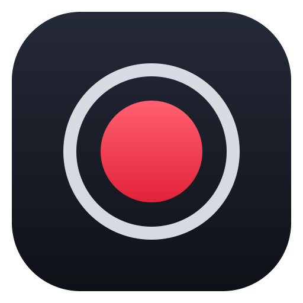
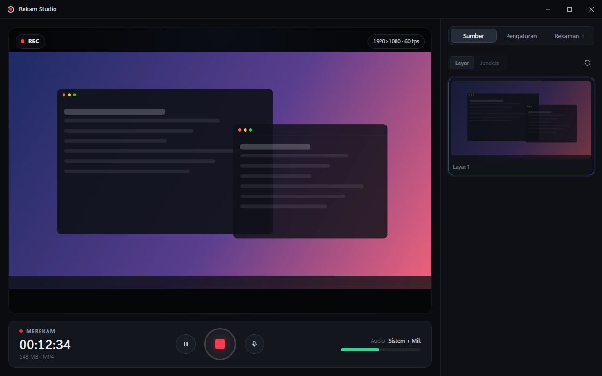

<div align="center">



# Rekam Studio

**Perekam layar HD untuk Windows, dengan tampilan modern dan minimalis.**
Ringan, lancar, dan gratis.

[](https://github.com/imronsf/rekam-layar-window/releases/latest)




</div>

---

## ✨ Fitur

| | |
|---|---|
| 🖥️ **Layar atau jendela** | Rekam seluruh layar atau satu jendela saja, dengan pratinjau langsung |
| 🎬 **Kualitas HD** | 720p, 1080p, 2K, hingga 4K, pada 30 atau 60 fps, dengan kualitas Standar, Tinggi, atau Ultra |
| ⚡ **Akselerasi hardware** | MP4 (H.264 + AAC) di-encode oleh GPU, sehingga rekaman tetap mulus dan CPU tidak terbebani |
| 🔊 **Audio sistem + mikrofon** | Keduanya bisa direkam sekaligus, dilengkapi peredam bising, meter level, dan tombol bisukan mik |
| ⏸️ **Jeda & lanjut** | Hitung mundur 3 detik, jeda/lanjut, dan pintasan keyboard global |
| 💾 **Langsung ke disk** | Data ditulis ke file setiap detik, jadi aman untuk rekaman berjam-jam |
| 🙈 **Tidak ikut terekam** | Jendela Rekam Studio otomatis disembunyikan dari hasil rekaman |
| 📂 **Pustaka rekaman** | Putar, buka folder, atau hapus rekaman (file dipindahkan ke Recycle Bin) |
| 📐 **Responsif** | Tampilan menyesuaikan ukuran jendela, dari layar penuh sampai jendela kecil |

---

## 📥 Cara Pemasangan

### Cara 1: Installer (disarankan)

1. Buka halaman **[Releases](https://github.com/imronsf/rekam-layar-window/releases/latest)**.
2. Unduh file **`RekamStudio-Setup-x.x.x.exe`**.
3. Jalankan file tersebut, pilih folder instalasi, lalu klik **Install**.
4. Buka **Rekam Studio** dari Desktop atau Start Menu.

> **Muncul peringatan "Windows protected your PC"?**
> Peringatan ini wajar untuk aplikasi baru yang belum memiliki sertifikat digital berbayar.
> Klik **More info**, lalu **Run anyway**.

### Cara 2: Portable (tanpa instalasi)

1. Unduh **`RekamStudio-Portable-x.x.x.exe`** dari halaman [Releases](https://github.com/imronsf/rekam-layar-window/releases/latest).
2. Simpan di folder mana saja (bisa juga di flashdisk), lalu klik dua kali untuk menjalankan.

### Menghapus aplikasi

Buka **Settings → Apps → Installed apps**, cari **Rekam Studio**, lalu klik **Uninstall**.

---

## 🎯 Cara Menggunakan

1. **Pilih sumber** di tab **Sumber**: *Layar* untuk seluruh layar, atau *Jendela* untuk satu aplikasi.
2. **Atur kualitas** di tab **Pengaturan**, yaitu resolusi, fps, format, dan audio.
3. Klik **tombol merah** untuk mulai merekam. Klik lagi untuk berhenti dan menyimpan.
4. Hasil rekaman ada di tab **Rekaman** dan tersimpan otomatis di folder `Videos\Rekam Studio`.

### Pintasan keyboard

| Pintasan | Fungsi |
|---|---|
| <kbd>Ctrl</kbd> + <kbd>Alt</kbd> + <kbd>R</kbd> | Mulai / hentikan rekaman |
| <kbd>Ctrl</kbd> + <kbd>Alt</kbd> + <kbd>P</kbd> | Jeda / lanjutkan |

Pintasan ini tetap berfungsi saat aplikasi diminimalkan.

### Tips

- Untuk rekaman yang paling lancar, pakai format **MP4** dengan kualitas **Tinggi**.
- Perkiraan ukuran file: 1080p 60 fps kualitas Tinggi menghasilkan ±95 MB per menit.
- Aktifkan **Minimalkan saat merekam** supaya jendela aplikasi langsung tersembunyi setelah rekaman dimulai.

---

## 💻 Persyaratan Sistem

- Windows 10 (versi 2004 atau lebih baru) atau Windows 11, 64-bit
- RAM 4 GB atau lebih
- Ruang disk yang cukup untuk menyimpan rekaman

---

## 🛠️ Untuk Developer

Dibuat dengan [Electron](https://www.electronjs.org/). Pastikan [Node.js](https://nodejs.org/) 20 atau lebih baru sudah terpasang.

```bash
git clone https://github.com/imronsf/rekam-layar-window.git
cd rekam-layar-window
npm install
npm start
```

| Perintah | Fungsi |
|---|---|
| `npm start` | Menjalankan aplikasi dalam mode pengembangan |
| `npm run selftest` | Uji otomatis: merekam ±5 detik lalu memastikan file bisa diputar |
| `npm run dist` | Membuat installer dan versi portable di folder `dist/` |

### Struktur proyek

```
main.js            Proses utama: jendela, capture, penulisan file, pintasan
preload.js         Jembatan API yang aman antara renderer dan proses utama
renderer/          Antarmuka (HTML, CSS, JavaScript)
tools/             Pembuat ikon dan uji otomatis
build/icon.png     Ikon aplikasi
```

---

<div align="center">

Dikembangkan oleh **[imron.sf](https://github.com/imronsf)** · Lisensi [MIT](LICENSE)

</div>
